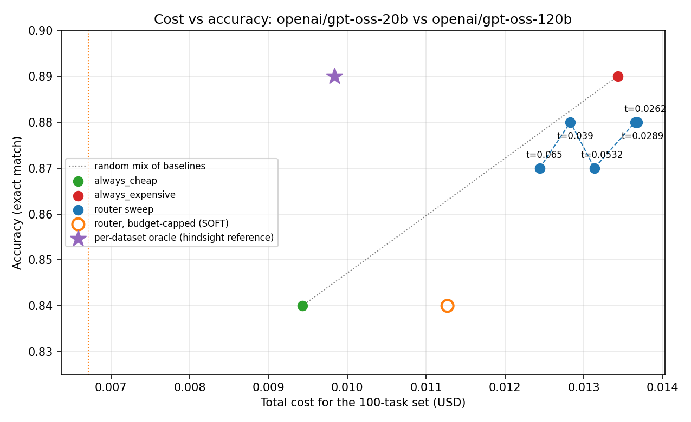

# CostRouter

**Cost-aware LLM routing for LangGraph agents.** Routes each agent step to a
cheap or expensive model based on task difficulty and remaining budget.

## Features

- **Difficulty-based routing**: Heuristic scorer uses prompt length, reasoning
  cues, and historical failure rates to estimate task difficulty (0-1).
- **USD budget tracking**: Thread-safe ledger with configurable thresholds,
  soft/hard-stop modes, and rate-card fallback estimation.
- **Retry-escalate**: If the cheap model produces malformed output, automatically
  retry with the expensive model — only if the budget allows it. Both calls are
  charged to the ledger.
- **Full audit trail**: Every routing decision is persisted to SQLite with cost,
  latency, and difficulty metadata.
- **Benchmark harness**: 3-condition comparisons (always-cheap, always-expensive,
  router) with policy sweep for Pareto analysis.
- **Streamlit dashboard**: Interactive Pareto curve, model choice distribution,
  and budget event visualizations.

## Quick Start

```bash
# Install with dev + dashboard dependencies
pip install -e ".[dev,dashboard]"

# Run tests
pytest

# Run the minimal example (no API keys needed)
python examples/minimal_graph.py
```

## Architecture

```
Upstream Agent Step
        |
        v
   RouterNode  --getDifficultyScore()--> DifficultyEstimator --> FailureRateStore
        |  --getRemainingBudget()-----> BudgetTracker
        |
        |--(cheap)----> Cheap Model  --+
        '--(expensive)-> Expensive Model -+
                                          v
                              Downstream Agent Step
                                          |
                                          v
                              BudgetTracker.record_actual_cost()
                                          |
                                          v
                              DecisionLogger --> SQLite
```

## Usage

### Basic Setup

```python
from costrouter import (
    BudgetTracker, HeuristicDifficultyEstimator, FailureRateStore,
    RouterNode, RouterConfig, ModelTier, BudgetMode,
)

# Define per-token rates for your models
rate_card = {
    ModelTier.CHEAP: {"prompt": 0.000001, "completion": 0.000002},
    ModelTier.EXPENSIVE: {"prompt": 0.00001, "completion": 0.00003},
}

# Initialize components
budget = BudgetTracker(
    initial_budget_usd=1.00,
    rate_card=rate_card,
    mode=BudgetMode.SOFT,   # force cheap when budget exhausted
)
failure_store = FailureRateStore(prior=0.5, min_samples=5)
estimator = HeuristicDifficultyEstimator(failure_store=failure_store)

config = RouterConfig(
    threshold=0.5,          # difficulty above this -> expensive model
    retry_on_error=True,    # retry-escalate on malformed output
)

router = RouterNode(
    cheap_model=your_cheap_model,      # implements ChatModelLike
    expensive_model=your_expensive_model,
    estimator=estimator,
    budget=budget,
    config=config,
)
```

### Real models

Any OpenAI-compatible endpoint (OpenAI, Groq, OpenRouter, …) works through
`OpenAICompatibleChatModel` (`pip install openai`). Requests default to
`temperature=0` and a fixed `seed`:

```python
import os
from costrouter.adapters import OpenAICompatibleChatModel

groq = dict(base_url="https://api.groq.com/openai/v1", api_key=os.environ["GROQ_API_KEY"])
your_cheap_model = OpenAICompatibleChatModel("openai/gpt-oss-20b", max_tokens=1024, **groq)
your_expensive_model = OpenAICompatibleChatModel("openai/gpt-oss-120b", max_tokens=1024, **groq)
```

Or wrap any LangChain chat model with `LangChainChatModel`. Either way, token
usage is read from the response and priced with your rate card, so keep the
rate card in sync with your provider's pricing.

```python
from langchain_openai import ChatOpenAI          # pip install langchain-openai
from costrouter.adapters import LangChainChatModel

your_cheap_model = LangChainChatModel(ChatOpenAI(model="gpt-4o-mini"))
your_expensive_model = LangChainChatModel(ChatOpenAI(model="gpt-4o"))
```

### With LangGraph

```python
from langgraph.graph import StateGraph, START, END

builder = StateGraph(dict)
builder.add_node("router", router)
builder.add_node("downstream", your_downstream_node)
builder.add_edge(START, "router")
builder.add_edge("router", "downstream")
builder.add_edge("downstream", END)

graph = builder.compile()
result = graph.invoke({
    "step_id": "q1",
    "prompt": "What is the capital of France?",
    "step_type": "qa",
})
```

### Running Benchmarks

The full real-model benchmark is one command (see [Benchmark results](#benchmark-results)):

```bash
pip install -e ".[benchmark,dashboard,report]"
python -m benchmark.download_data            # seeded 50 + 50 sample → data/ (already committed)
python -m benchmark.run --fresh              # needs GROQ_API_KEY (or OPENROUTER_/OPENAI_API_KEY) in .env
python -m benchmark.run --offline --fresh    # rebuild costrouter.db from the committed cache, no key
python notebooks/build_report.py             # re-execute the report notebook
```

`benchmark.run` calls each model once per prompt (responses are cached in
`data/response_cache/`), then runs `always_cheap`, `always_expensive`, a
5-threshold router sweep and a budget-capped router run into `costrouter.db`,
and writes `reports/summary.json` plus `reports/spot_check.csv` (every graded
answer). Use `--provider`, `--cheap-model`, `--expensive-model` and
`--cheap-rates/--expensive-rates` (USD per 1M tokens) to change models.

The library API underneath:

```python
from benchmark.datasets import load_triviaqa, load_gsm8k
from benchmark.graders import grade_triviaqa, grade_gsm8k
from benchmark.harness import run_benchmark, run_policy_sweep

results = run_benchmark(
    items=load_triviaqa("data/triviaqa_sample.json"),
    dataset_name="triviaqa",
    grader=grade_triviaqa,
    cheap_model=cheap,
    expensive_model=expensive,
    rate_card=rate_card,
)

# By default the router learns its failure-rate history only from its own
# validator failures (as in production). Pass learn_from_grades=True to also
# learn from gold-label grades — this uses the answer key, so report it.

# Policy sweep for Pareto curve
sweep = run_policy_sweep(
    items=load_triviaqa("data/triviaqa_sample.json"),
    dataset_name="triviaqa",
    grader=grade_triviaqa,
    cheap_model=cheap,
    expensive_model=expensive,
    rate_card=rate_card,
    thresholds=[0.2, 0.35, 0.5, 0.65, 0.8],
)
```

### Viewing Results

```bash
streamlit run dashboard/app.py -- --db costrouter.db
```

The dashboard opens the database read-only. Without `--db` it uses
`COSTROUTER_DB_PATH`, then `./costrouter.db`. The database isn't committed;
`python -m benchmark.run --offline --fresh` rebuilds it from the response cache.

## Benchmark results

Real run, 2026-10-12, on Groq: `openai/gpt-oss-20b` as the cheap model ($0.075 / $0.30 per
1M input/output tokens) and `openai/gpt-oss-120b` as the expensive one ($0.15 / $0.60). The
task set is 50 TriviaQA (`rc.nocontext` validation) + 50 GSM8K (test) items, seeded and
shuffled together; temperature 0, `max_tokens` 1024. Full write-up, charts and grading
spot-check: [`notebooks/pareto_report.ipynb`](notebooks/pareto_report.ipynb).



| Run | Accuracy | TriviaQA | GSM8K | Cost (100 tasks) | vs. always_expensive | Expensive share | Retries | Budget-forced | Unanswered |
|---|---|---|---|---|---|---|---|---|---|
| `always_cheap` | 84% | 72% | 96% | $0.0094 | 70% | 0% | 0 | 0 | 7 |
| `always_expensive` | 89% | 82% | 96% | $0.0134 | 100% | 100% | 0 | 0 | 0 |
| `router t=0.0262` | 88% | 80% | 96% | $0.0137 | 102% | 98% | 1 | 0 | 0 |
| `router t=0.0289` | 88% | 80% | 96% | $0.0137 | 102% | 97% | 1 | 0 | 0 |
| `router t=0.039` | 88% | 80% | 96% | $0.0128 | 96% | 80% | 1 | 0 | 0 |
| `router t=0.0532` | 87% | 78% | 96% | $0.0131 | 98% | 71% | 3 | 0 | 0 |
| `router t=0.065` | 87% | 78% | 96% | $0.0124 | 93% | 53% | 4 | 0 | 0 |
| `router t=0.0262`, cap $0.0067, SOFT | 84% | 72% | 96% | $0.0113 | 84% | 46% | 1 | 50 | 4 |
| `router t=0.0262`, cap $0.0067, HARD_STOP | 40% | 36% | 44% | $0.0064 | 48% | 94% | 1 | 1 | 53 |

What it shows:

- **The models differ only on TriviaQA** (72% vs 82%); both get 96% on GSM8K.
- **The v1 heuristic router roughly matches a random mix of the two models.** Its
  length + keyword score flags the long GSM8K problems as hard, which is where the models are
  equal. The failure-history signal partly corrects this (truncated cheap TriviaQA replies
  raise TriviaQA's score), but not enough. Routing by dataset with hindsight would reach 89%
  at 73% of the expensive cost, so the headroom exists for a better estimator (REQ-DIFF-2).
- **Retry-escalate works on real failures**: 7 cheap replies were empty because
  `gpt-oss-20b` spent all 1,024 tokens on hidden reasoning; the router's validator re-ran
  them on the expensive model, so every sweep point beats `always_cheap`.
- **SOFT isn't a spending cap**: it downgraded 50 steps but finished at 168% of the cap.
  **HARD_STOP held the cap** by refusing the last 53 steps.
- **Grading was checked by hand** (every answer marked wrong, and every correct answer that
  wasn't an exact alias match): no grader errors. One GSM8K gold label is wrong (item 49:
  2280, the correct total is 2180), and official labels are kept.

With 100 tasks, accuracy has a standard error of about ±3 points, so 1-point gaps between
thresholds are noise. To reproduce without an API key:
`python -m benchmark.run --offline --fresh` replays the committed response cache into
`costrouter.db`; then `streamlit run dashboard/app.py`.

## Configuration

### RouterConfig

| Parameter | Default | Description |
|---|---|---|
| `threshold` | 0.5 | Difficulty score above which expensive model is used |
| `budget_mode` | None | Optional check: raises `ValueError` if it differs from `BudgetTracker.mode` |
| `retry_on_error` | True | Retry with expensive model on cheap model failure (if affordable) |
| `max_completion_tokens` | None | Set to your providers' `max_tokens` to make the pre-flight check a worst-case bound |
| `validator` | None | Custom `Callable[[ModelResponse], bool]` for output validation |

### BudgetTracker

| Parameter | Default | Description |
|---|---|---|
| `initial_budget_usd` | required | Starting budget in USD |
| `rate_card` | required | Per-token USD rates per model tier |
| `mode` | SOFT | SOFT: force cheap when exhausted; HARD_STOP: raise `BudgetExhaustedError` |
| `warn_thresholds_pct` | (0.5, 0.1) | Budget % levels for warning callbacks |
| `on_threshold` | None | Callback `(pct, remaining) -> None`; runs outside the lock |

Before each call the router checks the budget can cover it: prompt tokens are
estimated at ~4 chars/token, and completion tokens are priced at
`RouterConfig.max_completion_tokens`. Set that to the same `max_tokens` you
configure on your providers and the check becomes a worst-case bound — with
`BudgetMode.HARD_STOP` the router then refuses any call it can't afford, so
spend can only exceed the budget by the prompt-token estimation error. If you
leave it unset, completion size is guessed as ≈ prompt size and a long answer
can overspend.

### DifficultyEstimator

| Parameter | Default | Description |
|---|---|---|
| `weights` | (0.3, 0.3, 0.4) | (length, cue, history) signal weights |
| `length_norm_chars` | 2000 | Character count where length signal saturates |
| `prior` | 0.5 | FailureRateStore cold-start prior |
| `min_samples` | 5 | Observations before switching to observed rate |

## Security

- The `costrouter` library never reads API keys. `benchmark/run.py` reads the
  provider key from `.env` / the environment and passes it straight to the
  client; it is never logged or stored — **never** commit `.env`.
- The response cache (`data/response_cache/`) stores model outputs and a hash
  of each prompt, not the prompt text.
- `DecisionLogger` stores only prompt **length** and a truncated SHA-256 hash,
  never the prompt text.

## Data Retention

Benchmark data is stored in a local SQLite database at the path you pass to
`init_db()` / `run_benchmark(conn=...)` (the harness defaults to in-memory;
`benchmark.run` writes `./costrouter.db`). Model responses are cached in
`data/response_cache/<provider>.jsonl`. Delete those files to remove all stored data.

## Testing

```bash
# Run all tests
pytest

# Run with verbose output
pytest -v

# Run specific test modules
pytest tests/test_budget.py
pytest tests/test_difficulty.py
pytest tests/test_router.py
pytest tests/test_store.py
pytest tests/test_harness_smoke.py
pytest tests/test_policy_sweep.py
pytest tests/test_graders.py
pytest tests/test_adapters.py
pytest tests/test_api_server.py
pytest tests/test_benchmark_run.py   # end-to-end runner, offline
pytest tests/test_dashboard.py       # headless Streamlit render
```

## License

MIT
